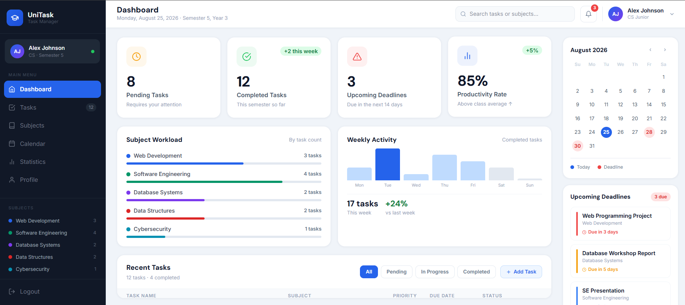

# Gestión de Tareas Universitarias

Plataforma web para que estudiantes universitarios organicen sus actividades académicas: crean materias, les asignan tareas con fecha límite y hacen seguimiento a su progreso desde un dashboard. Proyecto del curso Programación Web (IF2003), grupo 603.

**Dirección pública:** *(pendiente de publicar en Azure — ver [docs/definicion.md](docs/definicion.md), sección 15)*



## Integrantes

- *Alan Pareja*

## Stack

- ASP.NET Core MVC en **.NET 10** (SDK 10.0.302 o superior)
- Entity Framework Core 10 con **SQL Server** (local: SQL Server Express)
- ASP.NET Core Identity (login, roles Estudiante/Administrador)
- Bootstrap 5 + CSS propio (sin npm ni bundlers)

## Requisitos previos

1. [.NET SDK 10](https://dotnet.microsoft.com/download) instalado (`dotnet --version` ≥ 10.0.302).
2. **SQL Server Express** local (autenticación Windows) o cualquier SQL Server accesible.
3. La herramienta de EF Core (una sola vez):

   ```bash
   dotnet tool install --global dotnet-ef
   ```

## Ejecutar en local

1. Clona el repositorio y entra a la carpeta del proyecto:

   ```bash
   git clone https://github.com/alanpg261/Gestion-Tareas-Universitarias.git
   cd Gestion-Tareas-Universitarias/GestionTareasUniversitarias
   ```

2. Restaura los paquetes:

   ```bash
   dotnet restore
   ```

3. Configura la **cadena de conexión con secretos de usuario** (nunca va en el repositorio). El archivo [`appsettings.example.json`](GestionTareasUniversitarias/appsettings.example.json) muestra los nombres de las variables:

   ```bash
   dotnet user-secrets init   # solo la primera vez
   dotnet user-secrets set "ConnectionStrings:DefaultConnection" "Server=localhost\SQLEXPRESS;Database=GestionTareasUniversitariasDb;Trusted_Connection=True;TrustServerCertificate=True"
   ```

   > En Windows, usa `\\` en el servidor: `Server=localhost\\SQLEXPRESS`. Ajusta el valor según tu servidor.

4. Crea/actualiza la base de datos con las migraciones:

   ```bash
   dotnet ef database update
   ```

5. Ejecuta la aplicación:

   ```bash
   dotnet run --launch-profile https
   ```

   Abre **https://localhost:7218** (el navegador avisará del certificado de desarrollo; acepta y continúa).

En el entorno **Development** se crean automáticamente los roles y los usuarios de ejemplo de abajo.

## Usuarios de ejemplo

| Rol | Correo | Contraseña |
|------|------|------|
| Estudiante | `estudiante@ejemplo.com` | `Temporal123!` |
| Administrador | `admin@ejemplo.com` | `Temporal123!` |

## Documentación de la API

Con la aplicación corriendo en Development:

- Documento OpenAPI: `https://localhost:7218/openapi/v1.json`
- UI interactiva (Scalar): `https://localhost:7218/scalar/v1`
- Colección de Postman lista para importar: [`docs/postman/GestionTareasUniversitarias.postman_collection.json`](docs/postman/GestionTareasUniversitarias.postman_collection.json)

## Estructura del repositorio

```
GestionTareasUniversitarias/   Proyecto ASP.NET Core MVC
├── Controllers/               Controladores MVC y de la API (Api/)
├── Models/                    Modelos de dominio y modelos de vista
├── Views/                     Vistas Razor
├── Data/                      DbContext e inicializador (roles/usuarios)
├── Migrations/                Migraciones de EF Core
└── wwwroot/                   CSS y JS propios + librerías locales
docs/
├── definicion.md              Documento de definición del proyecto (fuente de verdad)
├── mockup/                    Mockups de las pantallas
├── presentacion/              Diapositivas de la sustentación
└── postman/                   Colección de Postman para probar la API
```

## Más información

El documento de definición con requerimientos, reglas de negocio, modelo de datos, arquitectura y despliegue está en [docs/definicion.md](docs/definicion.md).
